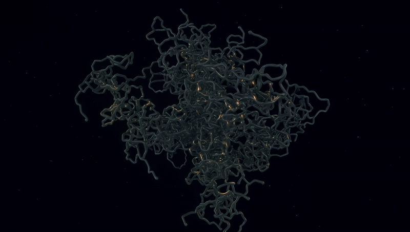

# TAU — the Alzheimer's protein, read to order

**TAU** (NP_005901.2) is the microtubule-associated protein that forms the
neurofibrillary tangles of Alzheimer's disease — the protein found clumped
inside dying neurons when the disease takes hold.

This repository is the full read of TAU, released for anyone to verify:
**13 products**, from the raw protein to the folded strand — measured
base-for-base, folded into a **5-D SPIRAL** fold of **hybrid DNA** — with the
numbers reproducible on any machine.

> **Drop-in ready.** The reading is done. The folding is done. The verification
> is done. You just print the letters — the strand is a finished DNA sequence,
> ready for any gene-synthesis service to synthesize. The hard part — the
> new-to-market methodology of folding and measuring — is already finished.

<p align="center">
  
</p>

> Part of the **NEUROMITOS** line — the full read of every neurodegenerative
> protein — at [panmitos.com/neuromitos](https://panmitos.com/neuromitos/).
> TAU is one of eight; the rest of the line is there.

## The claim, in one line

The raw tau protein, converted to DNA, measures a **spectral gap of −0.142**
(disordered — the signature of a misfolding protein). After an additive,
non-destructive fold through the **5-D SPIRAL**, every strand of **hybrid DNA**
measures **positive** (ordered).

You don't have to take our word for it. Run one script.

## Verify it yourself

```
python verify.py data/tau_base.dna        # → −0.142  (disordered)
python verify.py data/strands/core.dna    # → +0.046  (ordered)
python verify.py data/strands/working.dna # → +0.095  (ordered)
```

`verify.py` needs only `numpy`. It computes the spectral gap — the signed real
part of the second eigenvalue of the DNA strand's 4×4 base-transition matrix —
a value that is zero for random sequence and nonzero for structure.

## What's in this repo

- `data/tau_base.dna` — the raw protein converted to DNA (the "before").
- `data/strands/*.dna` — the corrected strands (the "after"), one file each.
- `data/strands.json` — full metadata for all 13 products.
- `hashes.txt` — the 13 SHA-256 hashes (prior-art anchor, see below).
- `verify.py` — the spectral-gap computation, free of any proprietary code.

## The 13 products

| product | kind | bases | spectral gap (λ₂) | SHA-256 (first 16) |
|---|---|---|---|---|
| The Working Code | working | 256 | +0.095 | 30c79e809b9ebac4 |
| The Core | strand | 11,024 | +0.046 | b6c9b80a2c30b1b5 |
| The Fold | strand | 11,024 | +0.046 | b6c9b80a2c30b1b5 |
| The Biology | strand | 11,032 | +0.043 | 8c6c9903c99b2704 |
| The Signal | strand | 11,032 | +0.043 | 03aabc886aed1256 |
| The Dark Matter | strand | 11,032 | +0.043 | 6e7f5b47e7d488d9 |
| The Hidden Rhythm | reading | — | — | 3f4bc339c3fa5593 |
| The Shape | reading | — | — | 42c65c9205d9f791 |
| The Stability | reading | — | — | 0fbabc66f22093ab |
| The Switch | reading | — | — | a63f62ec1d0717f6 |
| The Message | reading | — | — | e2296a7dc05d3b1e |
| The Spectrum | reading | — | — | fa6c2a1965c7b2bd |
| The Winding | reading | — | — | 7ea9b874f6168c09 |

The base strand (`tau_base.dna`) measures **−0.142**; all six folded products
measure positive. The seven readings are measurements of the same strand —
periodicity, secondary structure, thermal stability, regulatory motifs,
information entropy, Fourier spectrum, and nucleosome periodicity.

Every strand is **hybrid DNA** — never the unaltered original. No strand is
standard or original; each is a one-of-one hybrid, sealed with the moonlight.
**Sealed with the moonlight. One-of-one, provably yours.**

## Prior art + attribution

The 13 SHA-256 hashes in `hashes.txt` are anchored to the **Bitcoin blockchain**
via OpenTimestamps. The proof file `hashes.txt.ots` is included in this
repository, so anyone can independently verify that these bytes existed at the
moment of anchoring.

- File digest (sha256): `d8639bbfc50115361f7972a1a297926128f75f061322a0b28ee6d2db73955e3d`
- Verify: `ots verify hashes.txt.ots`

This release is the **result** of a proprietary folding pipeline. The strands
are free to use and study with attribution; the folding method itself is not
included and remains proprietary. See `LICENSE`.

---

## The rest of the line

TAU is one of eight proteins in the **NEUROMITOS** line — the protein-misfolding
diseases of the nervous system, read to order. The other seven — HTT (Huntington's),
APP (Alzheimer's), SNCA (Parkinson's), PRNP (prion), SOD1 (ALS), TARDBP (ALS),
and FUS (ALS) — are at:

- **[panmitos.com/neuromitos/](https://panmitos.com/neuromitos/)** — the NEUROMITOS thread
- **[panmitos.com](https://panmitos.com/)** — the full PANMITOS™ catalog

This free TAU read is the proof. The rest of the line — and every other line —
continues there.
