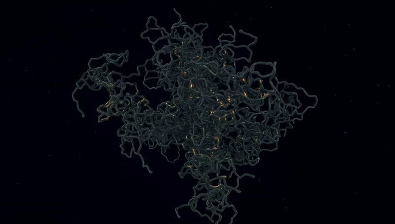

# TAU — measured, folded, released

**TAU** (NP_005901.2) is the microtubule-associated protein that forms the
neurofibrillary tangles of Alzheimer's disease — the protein found clumped
inside dying neurons when the disease takes hold.

This repository is a measurement of TAU: the protein sequence back-translated
to DNA, its spectral gap measured, the strand folded through a deterministic
**5-D SPIRAL**, and the resulting **hybrid DNA** sequences released for anyone
to synthesize. **13 products**, reproducible on any machine with one script.

> **Drop-in ready.** The strand is a finished DNA sequence — print the letters
> and hand them to any gene-synthesis service. Nothing to recalibrate: the
> back-translation, the measurement, and the fold are already done. You
> synthesize, then you test.

<p align="center">
  
</p>

> Part of the **NEUROMITOS** line — the measurement of every neurodegenerative
> protein — at [panmitos.com/neuromitos](https://panmitos.com/neuromitos/).
> TAU is one of eight; the rest of the line is there.

## What we did — and did not

We did three things, and nothing more:

1. **Back-translated** the TAU amino-acid sequence into DNA through the
   standard genetic code.
2. **Measured** the spectral gap — the signed real part of the second
   eigenvalue of the strand's 4×4 base-transition matrix.
3. **Folded** the strand through an additive, non-destructive 5-D spiral, and
   released the result.

We did **not** solve TAU's structure. We did **not** prove misfolding. A
spectral gap is a number. What a positive spectral gap means in a cell is an
open question — and it is the question this repository hands to you.

## The numbers

The raw protein, back-translated to DNA, measures a **spectral gap of −0.142**
(the "before"). After the fold, every strand of hybrid DNA measures **positive**
(the "after"): **+0.043 to +0.095**.

You don't have to take our word for it. Run one script.

## Verify it yourself

```
python verify.py data/tau_base.dna        # → −0.142  (before)
python verify.py data/strands/core.dna    # → +0.046  (after)
python verify.py data/strands/working.dna # → +0.095  (after)
```

`verify.py` needs only `numpy`. It computes the spectral gap — the signed real
part of the second eigenvalue of the DNA strand's 4×4 base-transition matrix —
a value that is zero for random sequence and nonzero for structure.

## What to test

The strands are finished DNA sequences. Print the letters and synthesize them.
The specific test:

- Synthesize the folded strand, express it alongside the base strand.
- Measure what changes — aggregation, solubility, microtubule binding.
- **We predict a shift. We do not claim it works. The cell reports.**

## The one claim that verifies itself

Independently, we encode data into DNA and decode it back losslessly —
GC-balanced, homopolymer-limited, error-corrected. Encode → synthesize →
sequence → decode == original. That claim is falsifiable in a day and needs no
biology to cooperate.

## What's in this repo

- `data/tau_base.dna` — the back-translated protein (the "before").
- `data/strands/*.dna` — the folded strands (the "after"), one file each.
- `data/strands.json` — full metadata for all 13 products.
- `hashes.txt` — the 13 SHA-256 hashes (prior-art anchor, see below).
- `verify.py` — the spectral-gap computation, free of any proprietary code.

## The 13 products

| product | kind | bases | spectral gap (λ₂) | SHA-256 (first 16) |
|---|---|---|---|---|
| The Working Code | working | 256 | +0.095 | 30c79e809b9ebac4 |
| The Core | strand | 11,024 | +0.046 | b6c9b80a2c30b1b5 |
| The Fold | strand | 11,024 | +0.046 | b6c9b80a2c30b1b5 |
| The Biology | strand | 11,032 | +0.043 | 8c6c9903c99b2704 |
| The Signal | strand | 11,032 | +0.043 | 03aabc886aed1256 |
| The Dark Matter | strand | 11,032 | +0.043 | 6e7f5b47e7d488d9 |
| The Hidden Rhythm | reading | — | — | 3f4bc339c3fa5593 |
| The Shape | reading | — | — | 42c65c9205d9f791 |
| The Stability | reading | — | — | 0fbabc66f22093ab |
| The Switch | reading | — | — | a63f62ec1d0717f6 |
| The Message | reading | — | — | e2296a7dc05d3b1e |
| The Spectrum | reading | — | — | fa6c2a1965c7b2bd |
| The Winding | reading | — | — | 7ea9b874f6168c09 |

The base strand (`tau_base.dna`) measures **−0.142**; all six folded products
measure positive. The seven readings are measurements of the same strand —
periodicity, secondary structure, thermal stability, regulatory motifs,
information entropy, Fourier spectrum, and nucleosome periodicity.

Every strand is **hybrid DNA** — never the unaltered original. No strand is
standard or original; each is a one-of-one hybrid, sealed with the moonlight.

## Prior art + attribution

The 13 SHA-256 hashes in `hashes.txt` are anchored to the **Bitcoin blockchain**
via OpenTimestamps. The proof file `hashes.txt.ots` is included in this
repository, so anyone can independently verify that these bytes existed at the
moment of anchoring.

- File digest (sha256): `d8639bbfc50115361f7972a1a297926128f75f061322a0b28ee6d2db73955e3d`
- Verify: `ots verify hashes.txt.ots`

This release is the **result** of a proprietary folding pipeline. The strands
are free to verify and research with attribution; resale and repackaging are
prohibited, and any commercial use requires a separate license with a 10% royalty.
The folding method itself is not included and remains proprietary. See `LICENSE`.

---

## Links

- **[panmitos.com](https://panmitos.com/)** — the full PANMITOS™ catalog.
- **[panmitos.com/chainlock/](https://panmitos.com/chainlock/)** — CHAINLOCK™: every product line hashed, rooted, and locked to the Bitcoin blockchain.
- **[forged-on-chain.com](https://forged-on-chain.com/)** — FORGED-ON-CHAIN LLC.
- **[automitos.com](https://automitos.com/)** — the AUTOMITOS self-thread: the recording identity.

---

## The rest of the line

TAU is one of eight proteins in the **NEUROMITOS** line — the protein-misfolding
diseases of the nervous system, measured and folded. The other seven — HTT
(Huntington's), APP (Alzheimer's), SNCA (Parkinson's), PRNP (prion), SOD1 (ALS),
TARDBP (ALS), and FUS (ALS) — are at:

- **[panmitos.com/neuromitos/](https://panmitos.com/neuromitos/)** — the NEUROMITOS thread
- **[panmitos.com](https://panmitos.com/)** — the full PANMITOS™ catalog

This free TAU measurement is the proof. The rest of the line — and every other
line — continues there.
